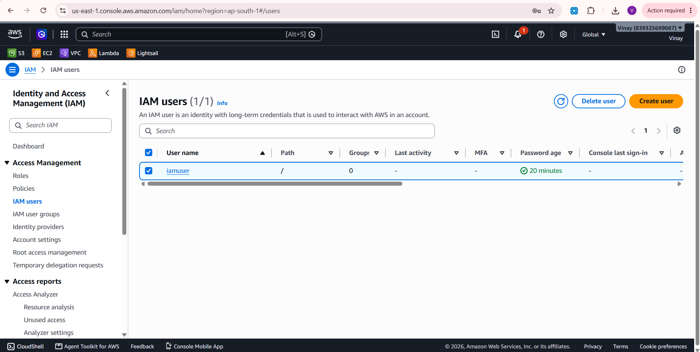
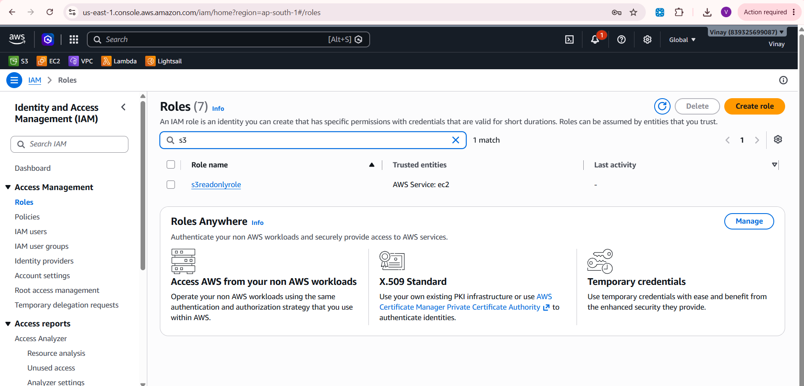
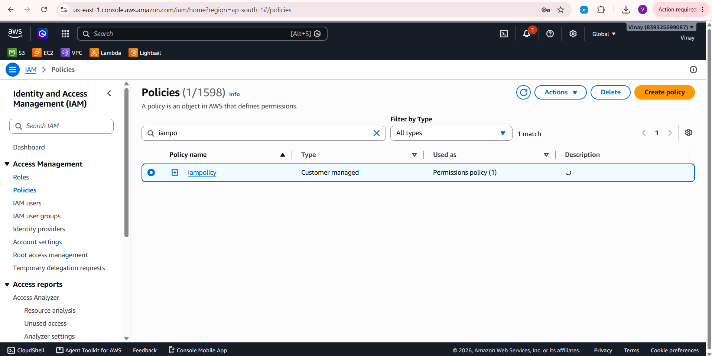
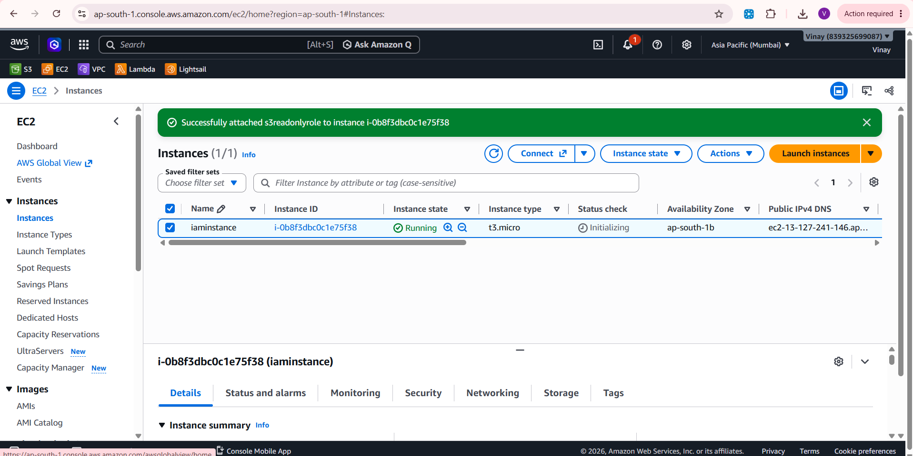

# AWS IAM and EC2 Setup: Users, Roles, Policies and an EC2 Instance

A hands-on AWS project that sets up access control with **AWS Identity and Access Management (IAM)** and launches an **Amazon EC2** instance. It covers creating IAM users, roles and policies, and launching a virtual server.

---

## Table of Contents

- [Project Overview](#project-overview)
- [Services Used](#services-used)
- [Prerequisites](#prerequisites)
- [Implementation Steps](#implementation-steps)
- [Screenshots](#screenshots)
- [Security Best Practices](#security-best-practices)
- [Key Learnings](#key-learnings)
- [Author](#author)

---

## Project Overview

Controlling who can do what in a cloud account is the foundation of AWS security. In this project I:

- Created an IAM user for day-to-day access
- Created an IAM role for `<EC2 / another service>`
- Attached IAM policies to grant only the permissions needed
- Launched an EC2 instance

**Goal:** Understand how identities, permissions and compute resources fit together on AWS.

---

## Services Used

| Service | Purpose |
|---------|---------|
| AWS IAM | Users, roles and policies for access control |
| Amazon EC2 | Virtual server (compute) |

---

## Prerequisites

- An active AWS account
- A web browser
- Basic understanding of cloud computing concepts

---

## Implementation Steps

### 1. IAM Users
- Opened the **IAM Console**, then **Users**, then **Create user**.
- Created the user `<user-name>`.
- Gave the user `<console access / programmatic access>`.
- Attached permissions through `<group name / policy name>`.

### 2. IAM Policies
- Opened **Policies** in the IAM Console.
- Used `<AWS managed policy name>` / created a custom policy named `<policy-name>`.
- The policy allows: `<describe what it allows, e.g. read-only access to S3>`.

### 3. IAM Roles
- Opened **Roles**, then **Create role**.
- Trusted entity: `<AWS service, e.g. EC2>`.
- Created the role `<role-name>` with the policy `<policy-name>` attached.

### 4. Launch an EC2 Instance
- Opened the **EC2 Console**, then **Launch instance**.
- Name: `<instance-name>`
- AMI: `<e.g. Amazon Linux 2023>`
- Instance type: `<e.g. t2.micro / t3.micro>`
- Key pair: `<key-pair-name>`
- Security group: `<describe inbound rules, e.g. SSH on port 22 from my IP>`
- IAM role attached to the instance: `<role-name, or remove this line if you did not attach one>`
- Waited for the instance state to become **Running**.

---

## Screenshots

### IAM Users

### IAM Roles

### IAM Policies

### EC2 Instance

---

## Security Best Practices

- Do not use the root account for daily work. Use IAM users or roles.
- Follow **least privilege**: grant only the permissions required.
- Prefer **IAM roles** over long-term access keys for services such as EC2.
- Enable **MFA** for users with console access.
- Restrict SSH access in the security group to your own IP, not `0.0.0.0/0`.
- Never commit access keys, secret keys or `.pem` files to this repository.
- Stop or terminate unused EC2 instances to avoid charges.

---

## Key Learnings

- Difference between IAM users, roles and policies
- How permissions are granted through policies
- How to launch and configure an EC2 instance
- Why least privilege matters in cloud security

---

## Author

**Vinay**
GitHub: [Vinay-PR-Gowda](https://github.com/Vinay-PR-Gowda)
